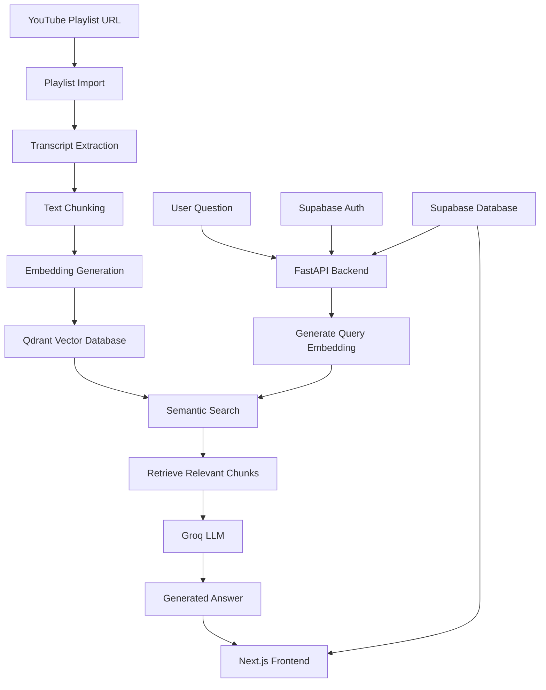

# LearnVault AI

**Turn YouTube playlists into your personal AI-powered learning assistant.**

LearnVault AI is a Retrieval-Augmented Generation (RAG) application that transforms educational YouTube playlists into searchable knowledge bases. Users can import playlists, ask questions about their content, and receive AI-generated answers grounded in relevant video transcripts.

Instead of manually searching through hours of video content, LearnVault AI helps learners find relevant information through natural-language conversations.

## Features

- **YouTube Playlist Import:** Import educational YouTube playlists dynamically.
- **Automatic Transcript Processing:** Extract transcripts and prepare them for semantic search through chunking.
- **Semantic Search:** Generate vector embeddings and retrieve relevant content using Qdrant.
- **RAG-Based Question Answering:** Generate context-aware answers using Groq-hosted LLMs.
- **Playlist-Scoped Retrieval:** Retrieve information from the selected playlist rather than unrelated content.
- **User Authentication:** Secure registration and login using Supabase Auth.
- **User-Specific Playlists:** Associate imported playlists with individual user accounts.
- **Persistent Chat History:** Save conversations and messages so users can revisit previous discussions.
- **Source-Aware Responses:** Return relevant source information alongside generated answers.

## Tech Stack

| Layer | Technologies |
|---|---|
| Frontend | Next.js, React, TypeScript, Tailwind CSS |
| Backend | Python, FastAPI |
| Authentication & Database | Supabase |
| Vector Database | Qdrant Cloud |
| Embedding Model | Sentence Transformers (`all-MiniLM-L6-v2`) |
| LLM | Groq |
| Video Processing | yt-dlp |
| API Communication | REST APIs |

## System Architecture



## How It Works

### 1. Playlist Ingestion

Users provide a YouTube playlist URL. The backend extracts playlist information and processes the available video transcripts.

### 2. Transcript Processing

The extracted transcripts are divided into smaller text chunks to make retrieval more efficient and contextually relevant.

### 3. Embedding Generation

Each text chunk is converted into a numerical vector using the `all-MiniLM-L6-v2` sentence-transformer model.

### 4. Vector Storage

The generated embeddings and associated metadata are stored in Qdrant Cloud, which supports similarity-based vector search.

### 5. Retrieval-Augmented Generation

When a user asks a question:

1. The question is converted into an embedding.
2. Qdrant searches for semantically similar transcript chunks.
3. Relevant chunks are retrieved from the selected playlist.
4. The retrieved context is passed to the Groq LLM.
5. The LLM generates an answer based on the retrieved information.

### 6. Authentication and Chat History

Supabase handles user authentication and persistent data storage.

Each user's playlists and conversations are associated with their account. Messages are stored in Supabase, allowing users to reopen previous conversations.

## Project Structure

```text
LearnVault-AI/
│
├── backend/
│   ├── app/
│   │   ├── api/
│   │   ├── core/
│   │   ├── db/
│   │   ├── schemas/
│   │   ├── services/
│   │   ├── main.py
│   │   └── database.py
│   │
│   ├── data/
│   │   ├── playlists/
│   │   ├── transcripts/
│   │   ├── chunks/
│   │   └── embeddings/
│   │
│   ├── requirements.txt
│   └── .env
│
├── frontend/
│   ├── app/
│   │   ├── components/
│   │   └── page.tsx
│   ├── lib/
│   ├── package.json
│   └── .env.local
│
└── README.md
```

*Note: The structure above highlights the main application directories; individual files may vary.*

## Getting Started

### Prerequisites

- Python 3.10+
- Node.js and npm
- A Supabase project
- A Qdrant Cloud account
- A Groq API key

### 1. Clone the Repository

```bash
git clone https://github.com/aryanduhan2203/LearnVault-AI.git
cd LearnVault-AI
```

### 2. Backend Setup

Navigate to the backend directory:

```bash
cd backend
```

Create and activate a virtual environment:

**Windows PowerShell:**

```powershell
python -m venv .venv
.\.venv\Scripts\Activate.ps1
```

Install dependencies:

```bash
pip install -r requirements.txt
```

Create a `.env` file inside the backend directory:

```env
SUPABASE_URL=your_supabase_project_url
SUPABASE_KEY=your_supabase_publishable_key

QDRANT_URL=your_qdrant_cluster_url
QDRANT_API_KEY=your_qdrant_api_key

GROQ_API_KEY=your_groq_api_key
```

Use the environment variable names expected by your actual backend configuration.

Start the backend:

```bash
uvicorn app.main:app --reload
```

Backend API:

```text
http://127.0.0.1:8000
```

FastAPI documentation:

```text
http://127.0.0.1:8000/docs
```

### 3. Frontend Setup

Open another terminal:

```bash
cd frontend
```

Install dependencies:

```bash
npm install
```

Create `.env.local`:

```env
NEXT_PUBLIC_SUPABASE_URL=your_supabase_project_url
NEXT_PUBLIC_SUPABASE_ANON_KEY=your_supabase_publishable_key
```

Start the development server:

```bash
npm run dev
```

Open:

```text
http://localhost:3000
```

### 4. Database Configuration

Configure the Supabase project with the required tables:

- `playlists`
- `conversations`
- `messages`

Enable Row Level Security (RLS) and configure policies to restrict access to each authenticated user's data.

Configure Qdrant Cloud with the collection expected by the backend and its vector dimension and distance metric.

## Security Considerations

- Supabase authentication protects user-specific application data.
- Row Level Security policies enforce data ownership.
- Backend endpoints validate authenticated user sessions.
- API keys and environment variables should never be committed to version control.
- The frontend uses the Supabase publishable key; privileged service-role credentials must remain server-side.

## Future Improvements

- Conversation deletion and improved conversation management.
- More detailed source citations with video timestamps.
- Retrieval evaluation and ranking improvements.
- Playlist deletion and failed-import retry workflows.
- Automated backend testing.
- Production deployment and performance optimization.

## Author

**Aryan Duhan**

B.Tech Computer Science and Engineering  
Vellore Institute of Technology, Chennai

- GitHub: https://github.com/aryanduhan2203

---

*LearnVault AI — Making long-form educational content easier to explore, understand, and learn from.*
